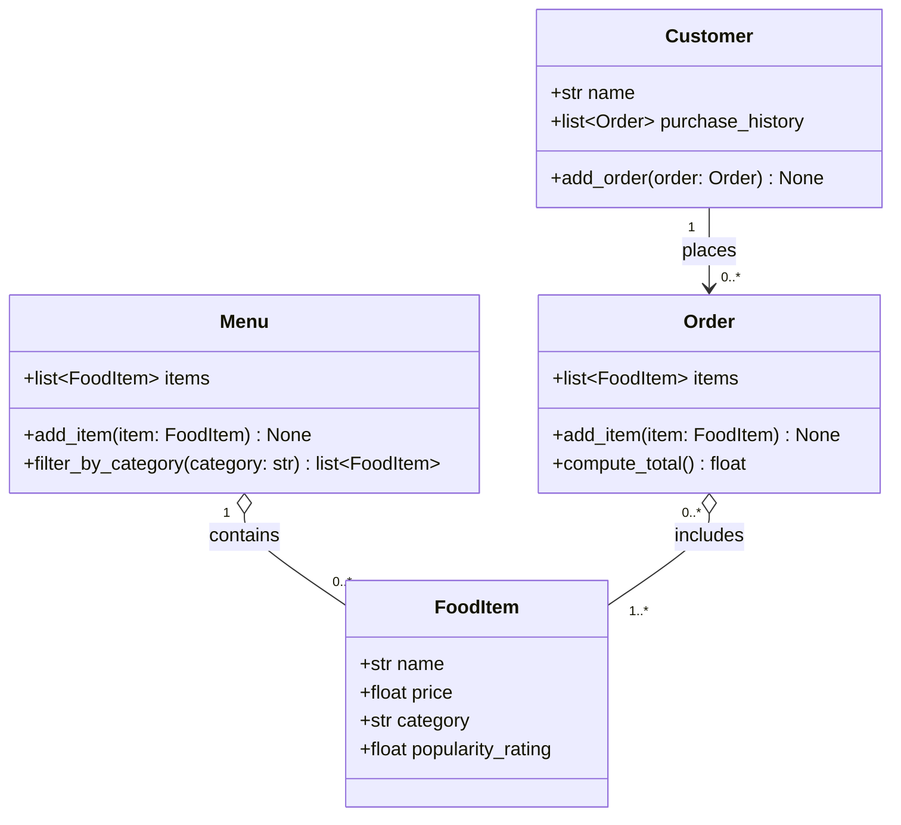

# ByteBites — UML Class Diagram (Revised)

## Traceability to the feature request

| Class | Member | Spec phrase |
|---|---|---|
| Customer | `name`, `purchase_history` | "tracking their names and their past purchase history so the system can verify they are real users" |
| Customer | `add_order()` | "manage our customers ... past purchase history" |
| FoodItem | `name`, `price`, `category`, `popularity_rating` | "track the name, price, category, and popularity rating" |
| Menu | `items`, `add_item()` | "manage the full collection of items ... a digital list that holds all items" |
| Menu | `filter_by_category()` | "lets us filter by category such as 'Drinks' or 'Desserts'" |
| Order | `items`, `add_item()` | "when a user picks items ... store the selected items" |
| Order | `compute_total()` | "compute the total cost" |

## Design notes

- **Verification**: there is no `is_verified()` method. The spec explains why purchase history is tracked, but nothing in it acts on a customer's verification status. Any future verification check can read `purchase_history` directly. New customers start with an empty history and can place orders normally.
- **Menu.filter_by_category()** matches categories case-insensitively ("drinks" matches "Drinks") and returns an empty list if nothing matches.
- **Order.compute_total()** sums the item prices. An empty order totals `0.0`.
- **Quantities**: ordering two of the same item means adding it twice. There is no separate quantity field.
- **Order → Customer**: an order does not store its customer. The link goes only from `Customer` to its orders through `purchase_history`, which avoids a circular reference.
- **Aggregation (◇)**: `FoodItem`s exist on their own. Menus and orders reference them but don't own them.
- **popularity_rating** is stored as data only. Nothing sorts or recommends by it, because AI recommendations are out of scope.

## Assumptions

1. **Open question for the client:** what makes someone a real user, and what should happen when a customer isn't verified? Once there's a concrete rule, `is_verified()` can come back with a real caller.
2. The `add_*` methods aren't named in the spec. They're the smallest way to "manage" the collections and to "pick" items.
3. `popularity_rating` is a `float`, for example 0.0–5.0. The spec gives no scale.
4. The spec's "Costumer" is a typo for **Customer**.
