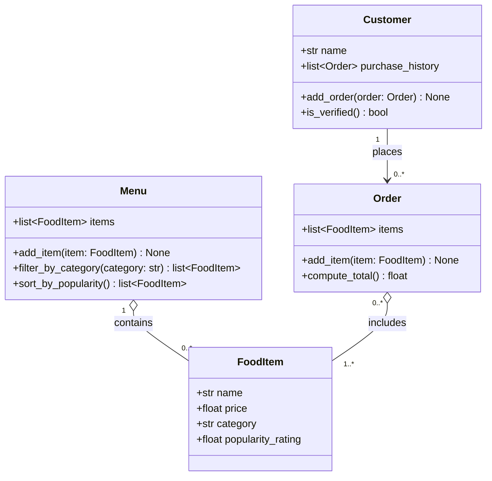

# ByteBites — UML Class Diagram

## Design notes

- **Customer.is_verified()** returns `True` if the customer has at least one past order.
- **Menu.filter_by_category()** matches categories case-insensitively ("drinks" matches "Drinks") and returns an empty list if nothing matches.
- **Menu.sort_by_popularity()** returns items sorted by `popularity_rating`, highest first. This is the simple "smart" hook for recommendations.
- **Order.compute_total()** sums the item prices. An empty order totals `0.0`.
- **Quantities**: ordering two of the same item means adding it twice. There is no separate quantity field.
- **Order → Customer**: an order does not store its customer. The link goes only from `Customer` to its orders through `purchase_history`, which avoids a circular reference.
- **Aggregation (◇)**: `FoodItem`s exist on their own. Menus and orders reference them but don't own them.
